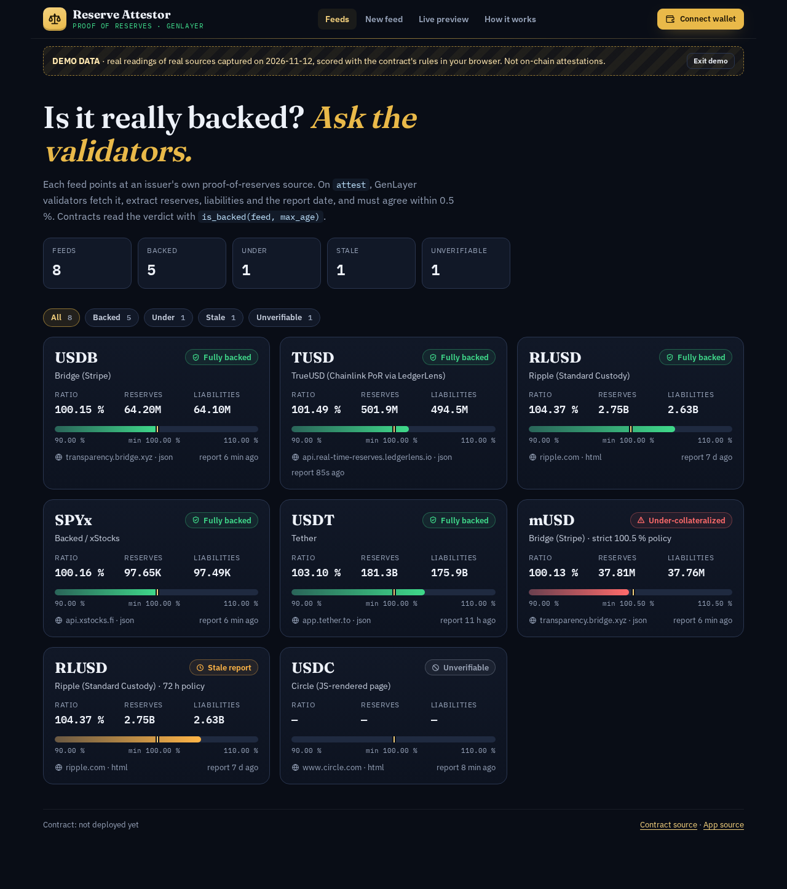

# Reserve Attestor dApp

**Is it really backed? Ask the validators.** A web app for the GenLayer Reserve Attestor Intelligent Contract: a registry of proof-of-reserves feeds where GenLayer validators read the issuer's own attestation source (a JSON endpoint or a transparency page), extract reserves, liabilities and the report date, and must agree on them. The contract computes the backing ratio and stores a status other contracts can depend on with one call: `is_backed(feed_id, max_age_hours)`.

- Contract source, tests and real-source fixtures: [gosof32/genlayer-reserve-atterstor](https://github.com/gosof32/genlayer-reserve-atterstor)
- Network: GenLayer Studionet (chain 61999)
- **Status: the contract is not deployed yet.** With no address configured the app says so plainly and offers clearly labelled demo data (below).



## What it is

| Page | What it does |
|---|---|
| **Feeds** (`#/`) | Every feed from `list_feeds` with its status (`FULLY_BACKED`, `UNDER_COLLATERALIZED`, `STALE`, `UNVERIFIABLE`), backing ratio, reserves, liabilities, a ratio gauge against the feed's minimum, report age, and filters by status. Registry stats from `get_stats`. |
| **Feed detail** (`#/feed/<id>`) | Figures of the latest verified reading (falls back to the last good one when the latest is unverifiable), the reason for a failure, the evidence string, a ratio-history chart and table (last 30 attestations), the full feed configuration and policy, and an **Attest now** button (respects the contract's 5-minute cooldown). |
| **New feed** (`#/create`) | A form that applies `create_feed`'s own validation rules in the same order (issuer, ticker, public https host, JSON paths or page labels, decimals, minimum ratio 1000-30000 bps, max age), with one-tap presets for the four real sources the contract was built against. |
| **Live preview** (`#/preview`) | Fetches a source from your browser and runs a JS port of the contract's reading rules (exact decimals, JSON paths, anchored HTML labels, dates, status) so you see what validators would read before anything is signed. If the browser blocks the read (CORS), it explains why and offers a bundled captured copy instead. |
| **How it works** (`#/how`) | The attest flow, consensus tolerances and the four statuses. |

**Wallet and transactions.** Injected MetaMask or any EIP-1193 wallet; the app adds and switches to Studionet with standard EIP-3085/3326 calls and never sees a private key. Every write is signed in the user's wallet. A transaction toast tracks **Sign → PENDING → ACCEPTED → FINALIZED**, links to the explorer, and shows the decoded verdict (for example `Fully backed · 100.15 %`) or the contract's revert reason. A write only counts once it is FINALIZED with validator agreement and a successful execution.

## Demo mode (not on-chain)

Open the app with `?demo=1` (or press **Browse demo data** / **Demo data** in the footer). A banner marks every page **DEMO DATA**, and attesting and creating are disabled.

The demo feeds are **real readings of real sources** captured on 2026-11-12 (the curl fixtures in `tests/fixtures/` plus repeated plain GETs in `docs/samples.jsonl`), each scored with the contract's rules by `src/lib/extract.js`. They cover all four statuses: Bridge USDB, TrueUSD, Ripple RLUSD, xStocks SPYx and Tether (fully backed), Bridge mUSD under a stricter 100.5 % policy (under-collateralized), Ripple under a 72 h max age (stale), and Circle's JavaScript-rendered page (unverifiable). **They are not on-chain attestations** and the feed ids are illustrative. Rebuild them with `node scripts/build-demo.mjs`.

## Local development

```bash
npm install
cp .env.example .env.local        # set VITE_CONTRACT_ADDRESS once the contract is deployed
npm run dev                       # http://localhost:5173
npm run build && npm run preview  # production build on http://localhost:4173
```

| Variable | Meaning |
|---|---|
| `VITE_CONTRACT_ADDRESS` | Reserve Attestor address on GenLayer Studionet. Empty = "Contract not deployed yet" state (demo data still available). |

Routing is hash based (`#/feed/3`, `#/create`) and the build uses relative paths, so `dist/` works on any static host.

## Tests

```bash
npm test     # vitest, jsdom
```

113 tests in 5 files:

- `extract.test.js` (50): the browser port of the contract's reading rules against the same real source bodies and expected numbers as the contract's own tests (USDB, TUSD, SPYx, Tether, Ripple HTML, Circle), every status path, injection and script-text checks, number/date/JSON helpers.
- `attestor.test.js` (29): `create_feed` validation rules, presets, normalisation of genlayer-js view results (Maps, BigInts), routes, formatting.
- `wallet.test.js` (12): wallet connect, Studionet add/switch, the write → finalize flow.
- `tx.test.js` (5): receipt checks (finalized, consensus agreement, revert reasons).
- `App.test.jsx` (17): not-deployed state, demo mode with all four statuses, create-feed validation and exact `create_feed` args, the attest toast lifecycle (signing → PENDING → ACCEPTED → FINALIZED, errors, cooldown), contract read errors, and the live-preview CORS fallback. Wallet, RPC and fetch are all mocked.

## Deploy on Vercel

1. In Vercel, **Add New → Project** and import `gosof32/reserve-attestor-dapp` from GitHub.
2. Framework preset: **Vite**.
3. Build command: `npm run build`. Output directory: `dist`.
4. Environment variable: `VITE_CONTRACT_ADDRESS` = the deployed Reserve Attestor address (leave empty until the contract is deployed; the app then shows the not-deployed state and demo data).
5. Deploy. After changing `VITE_CONTRACT_ADDRESS`, redeploy: Vite inlines it at build time.

## Limitations

- **The contract is not deployed yet.** Until `VITE_CONTRACT_ADDRESS` is set, there are no on-chain feeds and nothing can be signed; only demo data and the live preview work. To deploy it, follow the contract repo's README ([gosof32/genlayer-reserve-atterstor](https://github.com/gosof32/genlayer-reserve-atterstor)).
- **Live preview and CORS:** of the real sources, only the TrueUSD endpoint (`api.real-time-reserves.ledgerlens.io`) allows browser reads from another origin. For Bridge, Ripple and xStocks the browser blocks the fetch; the preview says so and reads a bundled captured copy instead. This only limits the browser: validators fetch from their own servers, where CORS does not apply.
- The preview for HTML sources shows the amount the contract's grounding check expects; on-chain, an LLM locates the snippet and the contract verifies it, which the browser does not reproduce.
- Demo readings are a point-in-time capture from 2026-11-12, not a live feed.

## Screenshots

| | 390 px | 1280 px |
|---|---|---|
| Not deployed | [view](docs/screenshots/not-deployed-390.png) | [view](docs/screenshots/not-deployed-1280.png) |
| Feeds (demo) | [view](docs/screenshots/demo-feeds-390.png) | [view](docs/screenshots/demo-feeds-1280.png) |
| Feed detail, fully backed (demo) | [view](docs/screenshots/demo-feed-1-390.png) | [view](docs/screenshots/demo-feed-1-1280.png) |
| Feed detail, unverifiable (demo) | [view](docs/screenshots/demo-feed-8-390.png) | [view](docs/screenshots/demo-feed-8-1280.png) |
| New feed | [view](docs/screenshots/create-390.png) | [view](docs/screenshots/create-1280.png) |
| Live preview | [view](docs/screenshots/preview-390.png) | [view](docs/screenshots/preview-1280.png) |
| How it works | [view](docs/screenshots/how-390.png) | [view](docs/screenshots/how-1280.png) |

## License

MIT
